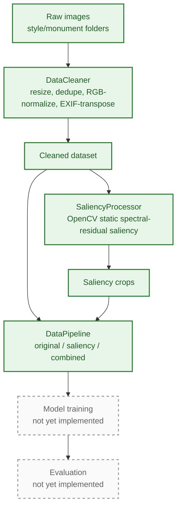

<div align="center">

# Indian Monument Architectural Style Classification

**A deep learning pipeline that classifies photographs of Indian monuments into architectural styles — Ancient Caves, Buddhist, Colonial, Delhi Sultanate, Dravidian, Mughal, Nagara, and Rajput — using saliency-guided preprocessing and transfer learning.**


[](https://www.python.org/)
[](https://www.tensorflow.org/)
[](https://opencv.org/)
[](https://jupyter.org/)
[](LICENSE)

</div>

---

> ### 🚧 Work in progress
>
> This repository is a **work in progress**. The data preparation half of the project — cleaning,
> saliency-guided cropping, and the `tf.data` input pipeline — is implemented and has been run
> end to end on the full dataset. **Model training and evaluation are not implemented yet**;
> they are the next stage of the project. See
> [Project Status](#project-status) for the full breakdown and [Remaining Work](#remaining-work)
> for what comes next.
>
> **There are no classification accuracy numbers in this repository yet** — no model has been trained.

---

## Table of Contents

- [Overview](#overview)
- [Project Status](#project-status)
- [Pipeline](#pipeline)
- [Preprocessing Results](#preprocessing-results)
- [Dataset](#dataset)
- [Key Techniques Implemented So Far](#key-techniques-implemented-so-far)
- [Tech Stack](#tech-stack)
- [Repository Structure](#repository-structure)
- [Getting Started](#getting-started)
- [Verified Environment](#verified-environment)
- [Remaining Work](#remaining-work)
- [Known Limitations](#known-limitations)
- [License](#license)

---

## Overview

India has a rich architectural history, and monuments from different regions and dynasties often
share visual similarities that make manual classification difficult. The goal of this project is a
computer vision pipeline that predicts the **architectural style** of a monument photograph.

The core hypothesis being tested is that **saliency-guided cropping** — isolating the visually
distinctive region of each photograph and adding it to the training set as an extra example —
improves classification accuracy over training on the raw images alone. Testing that hypothesis
requires two things: a preprocessing stage that produces both dataset variants, and a training
stage that measures the difference between them.

**This repository currently delivers the first of those two.** The dataset is cleaned, saliency crops are
generated, and both variants are exposed through a single configurable `tf.data` pipeline that a
model can be dropped straight onto.

Everything lives in a single, self-contained notebook: [`holy_grail.ipynb`](holy_grail.ipynb).

## Project Status

| Stage | Component | Status |
|---|---|:--:|
| 1 | Environment setup, GPU + mixed-precision configuration | ✅ Done |
| 2 | `Config` — paths, output directory layout, validation | ✅ Done |
| 3 | `DataCleaner` — resize, dedupe, RGB-normalize, EXIF-transpose | ✅ Done |
| 4 | `SaliencyProcessor` — spectral-residual saliency crops + fallback | ✅ Done |
| 5 | `ExperimentConfig` — per-run configuration and logging | ✅ Done |
| 6 | `DataPipeline` — `tf.data` loading, style labels, mixup, batching | ✅ Done |
| 7 | Pipeline verification — split sizes, batch shapes, sample preview | ✅ Done |
| 8 | `ModelFactory` — InceptionV3 / InceptionResNetV2 backbones + head | ⬜ Not started |
| 9 | Two-phase transfer learning (freeze → fine-tune) | ⬜ Not started |
| 10 | Experiment runner (2 backbones × 2 dataset variants) | ⬜ Not started |
| 11 | Evaluation — accuracy, confusion matrices, per-class breakdown | ⬜ Not started |
| 12 | Results comparison table and figures | ⬜ Not started |

## Pipeline

Solid boxes are implemented and have been run on the full dataset; dashed boxes are planned.



The pipeline is already parameterized for all four planned experiments — `DataPipeline` accepts a
`dataset_type` of `original`, `saliency`, or `combined`, and `ExperimentConfig` selects the
backbone and batch size. Only the model and training loop are missing.

| # | Model | Dataset | Batch size | Status |
|---|---|---|---:|:--:|
| 1 | InceptionV3 | Original | 24 | ⬜ Planned |
| 2 | InceptionResNetV2 | Original | 16 | ⬜ Planned |
| 3 | InceptionV3 | Original + Saliency (combined) | 16 | ⬜ Planned |
| 4 | InceptionResNetV2 | Original + Saliency (combined) | 8 | ⬜ Planned |

## Preprocessing Results

The saliency stage has been run over the full dataset. Output taken directly from the notebook's
executed cells:

```text
==================================================
🎯 SALIENCY CROPPING COMPLETE
==================================================
✅ Total images processed: 5579
🎯 Saliency detected:      2808 (50.3%)
🔄 Fallback used:          2771
📸 Total crops:            6002
==================================================
```

Two things worth noting from this run:

- **Saliency detection succeeds on roughly half the images (50.3%).** For the other half, the
  detector either finds no region or finds one below the 256px minimum crop size, and the
  center-crop fallback is used instead. Whether the fallback crops help or hurt is an open
  question that the training experiments should answer.
- **6,002 crops from 5,579 images** — slightly more than one crop per image on average, since the
  detector may propose up to 3 valid regions per image. The combined dataset is therefore a little
  over twice the size of the original.

## Dataset

Labels are assigned at the **style** level (the grandparent folder of each image), not the
individual monument. The monument-level folder is only used for organizing and sourcing images.

Image counts per style, read from the preprocessing run log:

| Architectural Style | Train | Test | Total | Monuments |
|---|---:|---:|---:|---|
| `Ancient_Caves` | 368 | 72 | 440 | Ajanta Caves, Ellora Caves |
| `Buddhist` | 112 | 45 | 157 | Buddhist Monuments |
| `Colonial` | 675 | 130 | 805 | Basilica of Bom Jesus, Gateway of India, India Gate, Victoria Memorial |
| `Delhi_Sultanate` | 778 | 186 | 964 | Alai Darwaza, Alai Minar, Jamali Kamali Tomb, Qutub Minar |
| `Dravidian` | 817 | 280 | 1097 | Airavatesvara Temple, Madurai Meenakshi Gopurams, Gangaikonda Cholapuram Vimana, Tanjavur Temple |
| `Mughal` | 505 | 164 | 669 | Chhota Imambara, Fatehpur Sikri, Humayun's Tomb, Taj Mahal |
| `Nagara` | 467 | 112 | 579 | Khajuraho, Mukteshwar, Sun Temple Konark |
| `Rajput` | 692 | 202 | 894 | City Palace Udaipur, Hawa Mahal, Jaisalmer Fort |
| **Total** | **4414** | **1191** | **5605** | **25** |

**The dataset is noticeably imbalanced** — `Dravidian` has roughly 7× as many images as
`Buddhist`, and `Buddhist` is sourced from a single monument folder. This is a known risk for the
training stage and is listed under [Remaining Work](#remaining-work).

> ⚠️ The saliency stage reports **5,579** images processed against the **5,605** counted here.
> That 26-image gap is unexplained and needs to be tracked down before the training runs — see
> [Known Limitations](#known-limitations).

## Key Techniques Implemented So Far

- **Saliency-guided cropping** — OpenCV's static spectral-residual saliency detector proposes up
  to 3 salient regions per image; valid crops (≥256px) are kept as additional training examples,
  with a center-crop fallback when saliency detection doesn't find a usable region
- **Style-level labelling** — a custom `tf.data` loader walks the two-level
  `style/monument/` folder hierarchy and assigns the label from the grandparent directory, since
  Keras' built-in `image_dataset_from_directory` only labels from the immediate parent
- **Mixup augmentation** — training batches are blended pairwise (`Beta(0.2, 0.2)` mixing) via
  TensorFlow Probability to improve generalization
- **Mixed precision** (`mixed_float16`) — enabled automatically when a capable GPU is detected
- **Memory-conscious defaults** — images capped at 1024px during cleaning, reduced batch sizes and
  prefetch buffers, `gc.collect()` between stages — tuned for a single consumer GPU (see
  [Verified Environment](#verified-environment))

## Tech Stack

| Layer | Technology |
|---|---|
| Image processing | OpenCV (saliency detection), Pillow |
| Data pipeline | TensorFlow (`tf.data`), TensorFlow Probability (mixup), NumPy |
| Visualization | Matplotlib |
| Environment | Jupyter Notebook |
| *Planned* | *TensorFlow / Keras (InceptionV3, InceptionResNetV2), scikit-learn, pandas, seaborn* |

## Repository Structure

```text
holy_grail.ipynb     Cleaning, saliency preprocessing, and the tf.data input pipeline
requirements.txt     Python dependencies for the current stage
```

The image dataset and all generated outputs (cleaned images, saliency crops, logs) are **not**
checked into this repository — see [Getting Started](#getting-started) for how the notebook
expects them to be laid out locally.

## Getting Started

### 1. Install dependencies

```bash
pip install -r requirements.txt
```

`cv2.saliency` requires the **contrib** build of OpenCV (`opencv-contrib-python`), not the plain
`opencv-python` package — this is already reflected in `requirements.txt`.

### 2. Organize your dataset

The notebook expects a `train`/`test` split, each containing one folder per architectural style,
each of those containing one or more monument subfolders of images:

```text
Indian-monuments/
├── train/
│   ├── Ancient_Caves/<monument>/*.jpg
│   ├── Buddhist/<monument>/*.jpg
│   ├── Colonial/<monument>/*.jpg
│   ├── Delhi_Sultanate/<monument>/*.jpg
│   ├── Dravidian/<monument>/*.jpg
│   ├── Mughal/<monument>/*.jpg
│   ├── Nagara/<monument>/*.jpg
│   └── Rajput/<monument>/*.jpg
└── test/
    └── (same structure as train)
```

Folder names must match the 8 style names above exactly — anything else is logged as an
unrecognized style and silently skipped rather than raising an error.

### 3. Point the notebook at your dataset

In the `Config` class (second code cell), update the two paths to match your machine:

```python
raw_root: Path = Path(r"D:\monument_dataset\Indian-monuments")        # your dataset root
out_root: Path = Path(r"D:\monument_dataset\ivp_dataset_processed")   # where processed output goes
```

Everything else (saliency crops, logs, and the output directories reserved for the training stage)
is derived from `out_root` automatically.

### 4. Run it

```bash
jupyter notebook holy_grail.ipynb
```

Run cells top to bottom. The notebook will clean the dataset, generate saliency crops, build the
input pipeline, and finish by printing dataset statistics and previewing a training batch.
Cleaning and saliency generation are the slow steps; both skip work that already exists on disk,
so re-running is cheap.

## Verified Environment

The preprocessing run above was produced with:

| | |
|---|---|
| Python | 3.9.23 |
| TensorFlow | 2.10.1 |
| NumPy | 1.23.5 |
| OpenCV | 4.8.1 (contrib, saliency module available) |
| GPU | NVIDIA GeForce RTX 3050 Laptop GPU, mixed-precision (`mixed_float16`) enabled |

TensorFlow is pinned to 2.10 in `requirements.txt` because it's the last release with native
Windows GPU support (2.11+ requires WSL2 on Windows). If you're on Linux/macOS, or don't need GPU
acceleration, this pin can be relaxed.

## Remaining Work

Planned next, roughly in order:

1. **`ModelFactory`** — build InceptionV3 and InceptionResNetV2 backbones from ImageNet weights
   with a dropout classification head, plus a configurable augmentation layer
2. **Two-phase transfer learning** — Phase 1 trains the head with the backbone frozen (`1e-3`);
   Phase 2 unfreezes the top half of the backbone and fine-tunes at a much lower rate (`1e-5`)
3. **Experiment runner** — all 4 combinations of backbone × dataset variant, with session cleanup
   between runs so they fit in GPU memory
4. **Evaluation** — test accuracy, confusion matrices, and per-class precision/recall
5. **Comparison and figures** — a single results table plus charts, to quantify whether saliency
   augmentation actually helps
6. **Class imbalance handling** — decide between class weights, oversampling the smaller styles,
   or sourcing more images for `Buddhist` and `Ancient_Caves`
7. **Reconcile the 26-image discrepancy** between the cleaned dataset and the saliency stage

## Known Limitations

- **No model, no results yet.** Training and evaluation are the next stage; nothing
  in this repository produces a classification accuracy number.
- **The 26-image gap** between the 5,605 images counted per class and the 5,579 the saliency stage
  reports processing is unexplained and needs investigation.
- **Class imbalance is unaddressed** — `Dravidian` (1,097 images) vs `Buddhist` (157) is a ~7×
  spread, and no class weighting or resampling is applied yet.
- **The data cleaning cell has no saved output** in the committed notebook. It was run in an
  earlier kernel session (which is why the saliency stage had cleaned images to work from), but
  the summary and class distribution it prints aren't captured here. Re-running it will populate
  them.
- **Dataset is not included in this repository.** You'll need to source and organize your own
  monument image collection matching the structure above — none of the training data is
  redistributed here.
- **Config paths are hardcoded Windows-style absolute paths** and must be edited before running on
  another machine.
- **Single monolithic notebook** — there's no modular `.py` package, CLI, or automated test suite.
  Splitting the pipeline into importable modules is worth doing before the training code makes the
  notebook substantially longer.
- **The `combined` dataset variant is implemented but untested** — `DataPipeline` concatenates the
  original and saliency datasets, but that path hasn't been exercised end to end yet.

## License

This project's code is licensed under the [MIT License](LICENSE). The license covers the notebook
and pipeline code only — it does not grant any rights to monument photographs, since this
repository doesn't include or redistribute a dataset. If you add your own image collection, verify
you have the right to use and share it before publishing.
